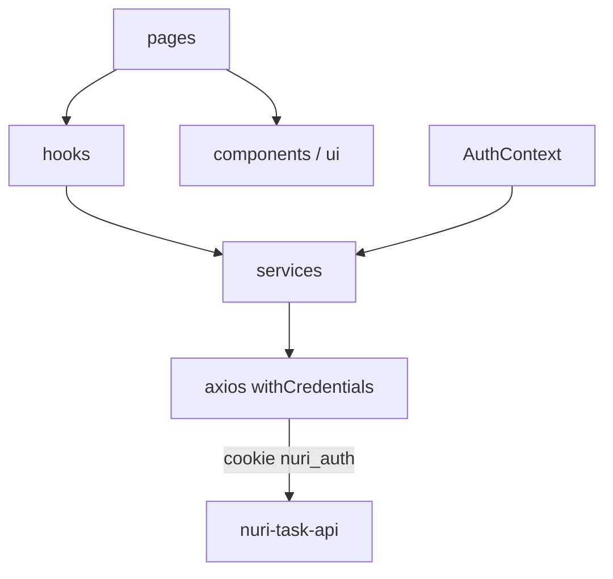

# Documentación técnica — Nuri Task App

Documento de referencia para entender el frontend: qué ve el usuario, cómo se monta la app, cómo habla con la API y dónde está cada pantalla. Verificado contra el código del repositorio.

**Repositorio:** [github.com/leo2143/nuri-task-app](https://github.com/leo2143/nuri-task-app)  
**App en producción:** https://nuri-task-app.vercel.app/login  
**API que consume:** [nuri-task-api](https://github.com/leo2143/nuri-task-api) — doc hermana en `nuri-task-api/DOCUMENTACION.md`

---

## Índice

1. [Qué es la app y para quién](#1-qué-es-la-app-y-para-quién)
2. [Cómo levantarla](#2-cómo-levantarla)
3. [Arquitectura](#3-arquitectura)
4. [Rutas y guards](#4-rutas-y-guards)
5. [Sesión y estado global](#5-sesión-y-estado-global)
6. [Cliente HTTP y servicios](#6-cliente-http-y-servicios)
7. [Hooks propios](#7-hooks-propios)
8. [Sistema de componentes](#8-sistema-de-componentes)
9. [Pantallas](#9-pantallas)
10. [Estilos y diseño](#10-estilos-y-diseño)
11. [PWA y offline](#11-pwa-y-offline)
12. [TypeScript](#12-typescript)
13. [Build y despliegue](#13-build-y-despliegue)
14. [Deuda técnica y limitaciones](#14-deuda-técnica-y-limitaciones)
15. [Mapa de archivos](#15-mapa-de-archivos)

---

## 1. Qué es la app y para quién

Nuri Task App es el cliente web de Nuri: tareas, metas, logros, rachas, moodboard y suscripción premium. Está pensada **primero para el teléfono** (viewport, footer fijo, bottom sheets, safe-area). El escritorio funciona, pero no es el diseño principal.

Es una **PWA**: se puede instalar, cachea assets y, si se corta la red, varias pantallas muestran el último dato guardado.

El usuario no es un “power user de productividad”. El tono de la UI (ilustraciones de Nuri, copy en voseo, confirmaciones) acompaña sin culpa. El front no inventa reglas de negocio: si una tarea está locked, el API la rechaza; la UI solo refleja eso.

### Stack (versión del `package.json`)

| Pieza | Tecnología | Para qué |
|-------|------------|----------|
| UI | React 19 | Componentes, StrictMode |
| Lenguaje | TypeScript 5.8 | Tipos de dominio y de respuesta API |
| Bundler | Vite 7 | Dev server, build, HMR |
| Rutas | React Router 6.30 | `createBrowserRouter`, lazy, `useBlocker` |
| Estilos | Tailwind 3.4 + PostCSS | Utility-first, mobile-first |
| HTTP | Axios 1.12 | Cookie de sesión (`withCredentials`) |
| Auth Google | @react-oauth/google | Code flow hacia el API |
| Imágenes | @cloudinary/react + url-gen | Upload y transformaciones |
| PWA | vite-plugin-pwa + Workbox 7 | SW, manifest, runtime cache |

---

## 2. Cómo levantarla

### Requisitos

- Node.js 20+
- El API corriendo (default `http://localhost:3000`) o la URL de prod en env

### Pasos

```bash
git clone https://github.com/leo2143/nuri-task-app.git
cd nuri-task-app
npm install
# Crear .env con las VITE_* de la tabla
npm run dev
```

Vite sirve en el puerto 5173 (default).

### Scripts

| Script | Qué hace |
|--------|----------|
| `npm run dev` | Vite + HMR |
| `npm run build` | `tsc -b && vite build` (typecheck + bundle + SW) |
| `npm run preview` | Preview del build |
| `npm run lint` | ESLint |
| `npm run format` | Prettier |

### Variables de entorno

Vite solo expone al browser lo que empieza con `VITE_`. Definidas en [`src/config/env.ts`](src/config/env.ts):

| Variable | Default | Propósito |
|----------|---------|-----------|
| `VITE_API_BASE_URL` | `http://localhost:3000` | Origin del API |
| `VITE_API_TIMEOUT` | `10000` | Timeout Axios (ms) |
| `VITE_GOOGLE_CLIENT_ID` | `""` | OAuth Google |
| `VITE_VAPID_PUBLIC_KEY` | fallback en código | Web Push (pública) |
| `VITE_SUBSCRIPTION_PRICE` | `"15"` | Copy del precio (alinear con `MP_SUBSCRIPTION_AMOUNT`) |

Cloudinary (preset / URL de upload) vive en `src/config/cloudinary.ts`, no en `env.ts`.

### Proxy de desarrollo

[`vite.config.ts`](vite.config.ts) proxea `/api` a `http://localhost:8888`. El default de `API_BASE_URL` es `:3000`. Si el API corre en 3000 y los servicios pegan a `API_BASE_URL` absoluto, **el proxy no se usa**. Ver §14.

---

## 3. Arquitectura

No existe `App.tsx`. El árbol se monta en [`src/main.tsx`](src/main.tsx):

```
StrictMode
  → GoogleOAuthProvider
    → AuthProvider
      → RouterProvider (router)
```

Antes del render, `setUnauthorizedHandler(() => router.navigate("/login"))` engancha el 401 de Axios al router **sin** import circular (Axios no importa React Router).



**Por qué esta capa y no Redux/Zustand.** El estado de sesión es el único global de verdad. Listas, filtros y forms viven en la página o en hooks. Un store global para “las tareas de hoy” se desincroniza con el servidor; acá el servidor manda y el hook cachea.

**Por qué pages → hooks → services.** La página no arma URLs. El hook no sabe de Axios. El servicio no sabe de React. Cada capa se puede cambiar (por ejemplo, el cache offline) sin reescribir la pantalla.

**Por qué lazy en todas las páginas.** El bundle inicial no arrastra admin, métricas ni formularios. `React.lazy` + `Suspense` + `Loading`. Si el chunk falla, `LazyErrorBoundary`.

---

## 4. Rutas y guards

Definidas en [`src/routes/router.tsx`](src/routes/router.tsx) con `createBrowserRouter`.

### Layouts

| Layout | Archivo | Chrome |
|--------|---------|--------|
| Público | `PublicLayout` | Solo `<Outlet />` (login, onboarding) |
| Protegido | `ProtectedLayout` | OfflineBanner, Navbar, main, Footer |
| Admin | `AdminLayout` | AdminNavbar, main, AdminFooter |

### Orden de `ProtectedRoute`

1. `isLoading` → splash `Loading`.
2. Sin sesión → `/login`.
3. Sin `emailVerified` (y no está en `/verify-email-pending`) → `/verify-email-pending`.
4. Sin `onboardingCompleted` (y no está en `/onboarding`) → `/onboarding`.
5. Si no, `<Outlet />`.

`PublicRoute`: si ya hay sesión, manda a `/`.  
`AdminRoute`: sesión + `user.isAdmin`; si no, `/forbidden`.

`/verify-email-pending` y `/onboarding` están en `PublicLayout` **sin** `PublicRoute` ni `ProtectedRoute`. El usuario ya está autenticado; `ProtectedRoute` lo redirige ahí.

**Premium:** `isPremium = user.isAdmin || user.subscription?.isActive`. Moodboard y métricas van envueltas en `PremiumGate` → si no es premium, muestra `SubscriptionPlan`.

### Lazy y fallbacks

`withSuspense(Component)` = `LazyErrorBoundary` → `Suspense fallback={<Loading />}` → página.  
`withPremium` = lo mismo + `PremiumGate`.  
Errores de ruta: `RootErrorBoundary` (`errorElement` global).

### Tabla de rutas

| Path | Página | Layout | Guard |
|------|--------|--------|-------|
| `/login` | Login | Public | PublicRoute |
| `/register` | Register | Public | PublicRoute |
| `/forgot-password` | ForgotPassword | Public | PublicRoute |
| `/reset-password` | ResetPassword | Public | PublicRoute |
| `/verify-email` | VerifyEmail | Public | — |
| `/verify-email-pending` | VerifyEmailPending | Public | — (post-auth) |
| `/onboarding` | Onboarding | Public | — (post-auth) |
| `/` | Home | Protected | ProtectedRoute |
| `/tasks` | TaskList | Protected | ProtectedRoute |
| `/tasks/new` | taskForm | Protected | ProtectedRoute |
| `/tasks/:id/edit` | taskForm | Protected | ProtectedRoute |
| `/tasks/:id` | Navigate → `/tasks` | Protected | ProtectedRoute |
| `/goals` | GoalList | Protected | ProtectedRoute |
| `/goals/:id` | GoalDetail | Protected | ProtectedRoute |
| `/goals/new` | GoalForm | Protected | ProtectedRoute |
| `/goals/:id/new/subgoal` | GoalSubGoalForm | Protected | ProtectedRoute |
| `/goals/:id/edit` | GoalForm | Protected | ProtectedRoute |
| `/achievements` | Achievements | Protected | ProtectedRoute |
| `/profile` | UserProfile | Protected | ProtectedRoute |
| `/moodboard` | Moodboard | Protected | ProtectedRoute + PremiumGate |
| `/metrics` | Metrics | Protected | ProtectedRoute + PremiumGate |
| `/notifications` | Notifications | Protected | ProtectedRoute |
| `/subscription` | Subscription | Protected | ProtectedRoute |
| `/subscription/success` | SubscriptionSuccess | Protected | ProtectedRoute |
| `/subscription/callback` | SubscriptionCallback | Protected | ProtectedRoute |
| `/admin` | AdminDashboard | Admin | AdminRoute |
| `/admin/users` | AdminUser | Admin | AdminRoute |
| `/admin/users/:id` | AdminUserDetail | Admin | AdminRoute |
| `/admin/users/new` | AdminUserForm | Admin | AdminRoute |
| `/admin/users/:id/edit` | AdminUserForm | Admin | AdminRoute |
| `/admin/achievements` | AdminAchievement | Admin | AdminRoute |
| `/admin/achievements/:id` | AdminAchievementDetail | Admin | AdminRoute |
| `/admin/achievements/new` | AdminAchievementForm | Admin | AdminRoute |
| `/admin/achievements/:id/edit` | AdminAchievementForm | Admin | AdminRoute |
| `/forbidden` | Forbidden | — | — |
| `*` | NotFound | — | — |

---

## 5. Sesión y estado global

Único context de dominio: [`src/context/AuthContext.tsx`](src/context/AuthContext.tsx).

### Por qué está partido en dos

| Context | Contenido |
|---------|-----------|
| `AuthStateContext` | `user`, `isAuthenticated`, `isLoading`, `isPremium` |
| `AuthActionsContext` | `login`, `logout`, `updateUser`, `refreshSubscription` |

Las acciones se memorizan con `useCallback`. Un componente que solo llama `login` (un form) **no** se re-renderiza cuando cambia `user`. Si todo viviera en un solo value, cada `setUser` re-renderizaría la app entera.

Hooks: `useAuthState()`, `useAuthActions()`, `useAuth()` (merge para guards).

### Dónde vive el token

**En una cookie HttpOnly que setea el API.** El JS no la lee. Axios manda `withCredentials: true`.

`localStorage["user"]` es **caché de UI** (nombre, avatar, flags) para no mostrar un flash vacío. No es la sesión. Si la cookie murió, `getSessionProfile` vuelve 401 y se limpia.

### Hidratación

Al montar `AuthProvider`:

1. Registra `setSessionExpiredHandler` (limpia estado).
2. Llama `userService.getSessionProfile()` → `GET /api/user/profile` con `skipUnauthorizedHandler: true`.
3. Si hay perfil → `persistUser` + estado autenticado.
4. Si 401 → `null`, sin redirigir (puede estar en `/login`).

### 401 coordinado

1. Interceptor Axios: borra `localStorage.user`, llama `sessionExpiredHandler`, luego `unauthorizedHandler` (salvo el skip).
2. `main.tsx`: el handler navega a `/login`.
3. `AuthContext`: el session handler pone `user = null`.

Logout: `POST /api/users/logout` (borra cookie) + `offlineStorage.clear()` + reset de estado.

`refreshSubscription` pega a `/api/subscription/status` y actualiza solo `subscription.isActive` (después del checkout de MercadoPago).

---

## 6. Cliente HTTP y servicios

[`src/config/axios.ts`](src/config/axios.ts):

- `baseURL = API_BASE_URL`, `timeout = API_TIMEOUT`, `withCredentials: true`.
- **401:** limpia sesión y redirige (ver §5).
- **403:** log.
- **404 en GET:** si el body trae `success` (envelope del API), **no** rechaza: devuelve `error.response`. Así `getTodoById` puede devolver `null` en vez de romper el hook.

**Por qué Axios y no `fetch`.** Interceptores, timeout, y `withCredentials` uniforme. El envelope del API es JSON predecible.

### Servicios (`src/services/`)

Patrón: función async → `apiClient.METHOD(url)` → `response.data.data` (o el envelope completo en listados).

Los servicios concatenan `${API_BASE_URL}/api/...` aunque Axios ya tiene `baseURL`. Funciona; está anotado en §14.

| Servicio | Responsabilidad | Endpoints que usa |
|----------|-----------------|-------------------|
| `userService` | Auth, perfil, admin users, email/password | `/api/users/*`, `/api/user/*`, `/api/auth/google`, `/api/admin/users/*` |
| `todoService` | CRUD tareas, estado, comentarios | `/api/todos/*`, `/api/goals/:goalId/todos` |
| `goalService` | CRUD metas, submetas, catálogo, status | `/api/goals/*` |
| `achievementService` | Plantillas (admin) | `/api/achievements/*` |
| `userAchievementService` | Progreso del usuario | `GET /api/user/achievements` |
| `metricsService` | Dashboard admin, métricas, racha | `/api/admin/dashboard`, `/api/metrics`, `/api/metrics/current-streak` |
| `moodboardService` | Tablero e imágenes | `/api/moodboard/*` |
| `subscriptionService` | activate / cancel / status | `/api/subscription/*` |
| `notificationApiService` | Inbox y unread | `/api/notifications/*` |
| `pushNotificationService` | PushManager + subscribe/unsubscribe | `/api/push/*` + APIs del browser |
| `cloudinaryService` | pending + delete | `/api/cloudinary/*` |

Upload binario: el browser habla con Cloudinary directo (`src/config/cloudinary.ts`). El API solo registra/borra metadatos.

---

## 7. Hooks propios

Barrel: `src/hooks/index.ts`.

### Fetching

| Hook | Para qué | Detalle |
|------|----------|---------|
| `useFetchById` | Un recurso por id | Flag `cancelled` en el cleanup del efecto |
| `useFetchList` | Lista + filtros | `filters` no va en deps (el padre manda `dependencies`) |
| `useFetchData` | Objeto único (perfil, stats) | `dependencies` como clave de refetch |
| `useFetch*Offline` | Igual + cache | Éxito → `offlineStorage.save`; error de red → `load` y `isOffline: true` |
| `useFilterableList` | Búsqueda + chips + cursor | Debounce 500 ms; compone `useFetchList`; `loadMore` pega al servicio |

**Flag `cancelled`.** Si el usuario cambia de página a mitad del fetch, el `setState` no corre sobre un componente desmontado. StrictMode monta dos veces en dev: el cleanup del primer efecto cancela ese run.

**`void run()`.** Sonar (regla S9383) exige que una Promise en un efecto se ignore explícitamente o se maneje. El try/catch ya está adentro de `run`; `void` le dice al linter “es a propósito”.

### Auth y navegación

| Hook | Para qué |
|------|----------|
| `useAuth` / `useAuthState` / `useAuthActions` | Sesión |
| `useAppNavigate` | `navigate` con `viewTransition: true` |
| `useHttpError` | Mensaje a partir del envelope Axios + `extractErrorMessage` |

### Formularios y UI

| Hook | Para qué |
|------|----------|
| `useUnsavedChanges` | Compara valores; `useBlocker` de RR; si confirma salir, borra imagen pending en Cloudinary |
| `useField` | Input controlado mínimo |
| `useClassNames` | Junta clases Tailwind |
| `useFormatDate` | Fechas `es-ES`, timezone UTC |
| `useNotifications` | Permiso + subscribe/unsubscribe push |
| `useCloudinaryUpload` | `fetch` al preset + `registerPendingImage` |

---

## 8. Sistema de componentes

No existe `components/features/` (aparece en convenciones viejas). Hay **design system** en `components/ui/` y **dominio/layout** en `components/`.

### Design system (`components/ui/`)

Controles: `Button`, `ButtonLink`, `Input`, `TextArea`, `Select`, `InputFilter`, `CustomCheckbox`, `ToggleSwitch`, `Spinner`.

Feedback: `ConfirmModal` (`<dialog class="nuri-dialog">`), `BottomSheet`, `FilterBottomSheet`, `Badge`, `StatusBadge`, `ProgressBar`, `Alert` (en `components/`).

Navegación/marca: `TramaHeader`, `TabGroup`, `Avatar`, `IconWrapper`.

Cards de dominio reutilizables: `GoalCard`, `TaskCard`, `AchievementCard`, `MetricCard`, `StreakCard`, `AdminCard`.

Paywall: `SubscriptionPlan`. Acción flotante: `ActionSelect`.

### Dominio y layout (`components/`)

| Pieza | Rol |
|-------|-----|
| Navbar / Footer / FooterBar / MenuNavItem | Chrome autenticado |
| AdminNavbar / AdminFooter | Chrome admin |
| Protected / Public / Admin Layout | Shell + `<Outlet />` |
| PremiumGate | Paywall |
| FilterableList | Lista + search + sheet de filtros + load more |
| VisualBoard | Grid de 11 slots del moodboard |
| ImageUploadSlot | File input oculto (`tabIndex={-1}`), variantes slot/avatar |
| CloudinaryImage | `AdvancedImage` + url-gen |
| Loading / LoadingMore / LoadMoreButton | Estados de carga |
| LazyErrorBoundary | Chunks lazy |
| OfflineBanner | `offline` / `online` |
| SideDrawer, BackButton | Navegación |

**FilterableList + `useFilterableList`.** La página solo pasa `fetchFn`, `buildFilters` y `renderItem`. El patrón se repite en tareas, metas, usuarios admin y logros admin.

---

## 9. Pantallas

### Públicas y auth

| Archivo | Ruta | Qué hace | Datos |
|---------|------|----------|-------|
| Login | `/login` | Email/password + Google | `userService`, `useAuthActions` |
| Register | `/register` | Alta | `userService` |
| ForgotPassword | `/forgot-password` | Pedir reset | `userService` |
| ResetPassword | `/reset-password` | Nueva clave con token | `userService` |
| VerifyEmail | `/verify-email` | Consume token; si hay user, `login()` | `userService` |
| VerifyEmailPending | `/verify-email-pending` | Reenvío con cooldown | `userService.resendVerification` |
| Onboarding | `/onboarding` | Carrusel; `completeOnboarding` | `userService` |

### App autenticada

| Archivo | Ruta | Qué hace | Datos |
|---------|------|----------|-------|
| Home | `/` | Tabs metas/tareas recientes, toggle completar, banner push | `goalService`, `todoService`, `useNotifications` |
| TaskList | `/tasks` | Lista filtrable + cursor | `useFilterableList` + `todoService` |
| taskForm | new / edit | CRUD; no edita locked | `todoService`, `goalService`, `useUnsavedChanges` |
| GoalList | `/goals` | Lista filtrable | `useFilterableList` + `goalService` |
| GoalDetail | `/goals/:id` | Tabs tareas/submetas, status | `useFetchByIdOffline`, `goalService`, `todoService` |
| GoalForm | new / edit | CRUD meta | `goalService`, `useUnsavedChanges` |
| GoalSubGoalForm | `.../subgoal` | Crear submeta | `goalService` |
| Achievements | `/achievements` | Grid por tier | `useFetchListOffline` + `userAchievementService` |
| UserProfile | `/profile` | Avatar, push, suscripción | `useFetchData`, `useCloudinaryUpload`, `subscriptionService` |
| Moodboard | `/moodboard` | CRUD imágenes (premium) | `moodboardService` + `offlineStorage` |
| Metrics | `/metrics` | KPIs y rachas (premium) | `useFetchDataOffline` + `metricsService` |
| Notifications | `/notifications` | Inbox cursor | `notificationApiService` |
| Subscription | `/subscription` | `SubscriptionPlan` | — |
| SubscriptionCallback | `/callback` | Poll `refreshSubscription` | Auth |
| SubscriptionSuccess | `/success` | Confirmación | — |

### Admin

| Archivo | Ruta | Datos |
|---------|------|-------|
| AdminDashboard | `/admin` | `metricsService.getAdminStats` |
| AdminUser / Detail / Form | `/admin/users/*` | `userService` |
| AdminAchievement / Detail / Form | `/admin/achievements/*` | `achievementService` + upload |

### Status

`NotFound` (`*`), `Forbidden` (`/forbidden`), `ServerError` + `RootErrorBoundary`, plantilla `StatusPage`.

---

## 10. Estilos y diseño

[`tailwind.config.js`](tailwind.config.js):

- Paleta: `primary`, `secondary`, `tertiary`, `brand`, `neutral`, `gray`, `greenCheap`, `yellowCheap`, `blueCheap`.
- Fuentes: `heading` = Montserrat Alternates; `body` = Nunito Sans (Google Fonts en `index.css`).
- Safe-area: padding/margin para notch.
- Animación `spin-slow` (loader). Sombras `brand-glow`, `brand-achievement`.

CSS global: [`src/index.css`](src/index.css) — layers Tailwind, fondos `.trama-*`, estilos de `dialog.nuri-dialog`, **View Transitions** (`fade-in` / `fade-out`), y `prefers-reduced-motion: reduce` que apaga animaciones.

**No hay GSAP en este repo.** Las transiciones de ruta usan la [View Transitions API](https://developer.mozilla.org/en-US/docs/Web/API/View_Transition_API) (`useAppNavigate`, `Link viewTransition`). Modales y sheets usan CSS/estado.

Ilustraciones de Nuri: `src/assets/ilustrations/` (estados emocionales) + `onboarding/`. Íconos SVG en `src/assets/svg-icons/` con barrel. Tramas en `src/assets/icons/`.

Mobile-first: `container px-4`, footer fijo, bottom sheets, `viewport-fit=cover` en `index.html`.

---

## 11. PWA y offline

[`vite.config.ts`](vite.config.ts) + [`src/sw.ts`](src/sw.ts):

| Capa | Estrategia |
|------|------------|
| Precache | `precacheAndRoute(__WB_MANIFEST)` — JS/CSS/HTML/fuentes del build |
| `/api/*` | **NetworkFirst**, cache `api-cache`, 50 entradas, 24 h |
| Cloudinary | **CacheFirst**, 100 entradas, 30 días |
| Push | handlers `push` y `notificationclick` en el SW |

Registro: `vite-plugin-pwa` con `registerType: "autoUpdate"`. Manifest: nombre, colores `#2F9685` / `#F7F6F2`, iconos 192/512/maskable.

**Segunda capa (app):** `src/utils/offlineStorage.ts` — JSON en `localStorage` con prefijo `nuri_offline_`. Lo usan los hooks `*Offline` y Moodboard. Logout hace `clear()`.

`OfflineBanner` en `ProtectedLayout` escucha `offline`/`online`.

Push: `useNotifications` + `pushNotificationService` + `VITE_VAPID_PUBLIC_KEY`. Subscribe manda `{ endpoint, keys }` al API.

**Por qué dos caches.** Workbox cubre HTTP genérico (incluso si el JS no pensó en offline). `offlineStorage` guarda el **shape de dominio** (lista de logros, detalle de meta) para pintar la UI igual que online.

---

## 12. TypeScript

`tsconfig.app.json`: `strict`, `jsx: react-jsx`, types de Vite y del plugin PWA.

Interfaces por dominio en `src/interfaces/`:

| Archivo | Contenido |
|---------|-----------|
| `IApiResponse.ts` | Envelope: success, error, created, pagination `meta` |
| `IUser.ts` | User, AuthUser, Profile, DTOs admin, filtros |
| `ITodo.ts` / `IGoal.ts` | Entidades, create/update, filtros |
| `IAchievement.ts` / `IUserAchievement.ts` | Plantilla vs progreso |
| `IMetrics.ts` | Dashboard admin y racha |
| `IMoodboard.ts` | Imágenes (frases tipadas pero feature no activa) |
| `INotification.ts` | Tipos de inbox |
| `IFilter.ts` | Config de chips/fechas para FilterableList |

`src/utils/typeGuards.ts` achica `unknown` de Axios a `IConflictResponse`, `IBadRequestResponse`, etc., y `extractErrorMessage` unifica el texto para `useHttpError`.

Validación de forms en cliente: `src/utils/validations.ts` (email, password, required). **No reemplaza a Zod del API**; evita un round-trip obvio.

---

## 13. Build y despliegue

Vite:

- Plugin React (Fast Refresh).
- PWA `injectManifest` (el SW es código nuestro, no el generado 100% automático).
- `manualChunks`: `react-vendor` = react + react-dom + react-router-dom. El resto de páginas ya van en chunks lazy.

[`vercel.json`](vercel.json):

- Rewrite `/(.*)` → `/index.html` (SPA: `/goals/123` no es un archivo).
- Headers: `X-Content-Type-Options`, `X-Frame-Options: DENY`, `X-XSS-Protection`.
- Cache largo en `/static/*`.

Variables en Vercel: las `VITE_*`. El build las incrusta: cambiar `VITE_API_BASE_URL` exige rebuild.

---

## 14. Deuda técnica y limitaciones

1. **GSAP no está.** Las reglas del monorepo lo listan; `package.json` no. Las animaciones son View Transitions + CSS. Si la tesis menciona GSAP, hay que aclarar que es intención / no implementado, o sacarlo del texto.
2. **`API_BASE_URL` duplicado.** Axios ya tiene `baseURL`; los servicios arman URLs absolutas. Un default mal puesto ignora el proxy.
3. **Proxy `:8888` vs default `:3000`.** Si alguien espera que `npm run dev` pegue al API vía proxy, no va a pasar salvo que apunte `VITE_API_BASE_URL` al origin de Vite (`http://localhost:5173`) para que `/api` se proxee.
4. **`VITE_VAPID_PUBLIC_KEY` tiene un fallback hardcodeado.** Es clave pública, no secreta, pero acopla un entorno concreto al código.
5. **No existe `components/features/`.** La convención del repo quedó atrás del árbol real.
6. **No hay tests.** Igual que el API.
7. **Moodboard no usa `useFetch*Offline`:** cachea a mano con `offlineStorage`. Mismo concepto, otra forma.
8. **`getTodosByGoal` en el servicio** pega a `/api/todos/goal/:goalId`; el API real de listado por meta es `GET /api/goals/:goalId/todos` (`getGoalTodos`). Conviene no mezclarlos al explicar el flujo de GoalDetail (usa `getGoalTodos`).

---

## 15. Mapa de archivos

| Pregunta | Dónde |
|----------|--------|
| ¿Cómo arranca? | `index.html`, `src/main.tsx` |
| ¿Qué rutas hay? | `src/routes/router.tsx`, `ProtectedRoute.tsx`, `PublicRoute.tsx`, `AdminRoute.tsx` |
| ¿Quién está logueado? | `src/context/AuthContext.tsx` |
| ¿Cómo se pega al API? | `src/config/axios.ts`, `src/services/*.ts` |
| ¿Env? | `src/config/env.ts`, `src/config/cloudinary.ts` |
| ¿Hooks? | `src/hooks/` |
| ¿Botones y cards? | `src/components/ui/` |
| ¿Navbar / layouts? | `src/components/` |
| ¿Pantallas? | `src/pages/<dominio>/` |
| ¿Tipos? | `src/interfaces/` |
| ¿Offline / fechas / guards? | `src/utils/` |
| ¿SW? | `src/sw.ts`, `vite.config.ts` |
| ¿Estilos? | `src/index.css`, `tailwind.config.js` |
| ¿Deploy? | `vercel.json` |

### Dependencias (resumen)

**Producción:** react, react-dom, react-router-dom, axios, @react-oauth/google, @cloudinary/react, @cloudinary/url-gen.

**Desarrollo:** vite, @vitejs/plugin-react, vite-plugin-pwa, typescript, tailwindcss, postcss, autoprefixer, eslint + plugins React/TS, prettier.

---

## Referencias oficiales usadas en el diseño

- [React](https://react.dev/) y [`lazy`](https://react.dev/reference/react/lazy)
- [React Router 6](https://reactrouter.com/en/main) — `createBrowserRouter`, `useBlocker`, view transitions
- [Vite](https://vite.dev/guide/)
- [TypeScript](https://www.typescriptlang.org/docs/)
- [Tailwind CSS](https://tailwindcss.com/docs)
- [Axios](https://axios-http.com/docs/intro)
- [HTML / a11y](https://developer.mozilla.org/es/docs/Web/HTML)
- [Vercel](https://vercel.com/docs)
